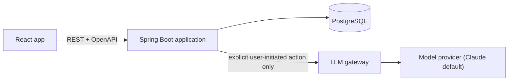

# Workspace Core: Design Spec

**Date:** 2026-11-11
**Status:** Draft for review
**Sub-project:** 1 of 5 (workspace core). Later sub-projects each get their own spec: materials, capture and discovery, autofill, interview.
**Background:** [AI_Career_Copilot_Competitive_Research.md](../../research/AI_Career_Copilot_Competitive_Research.md), especially Sections 4, 5.4, 7 and 7A.

## 1. Goal

A job seeker can take a real application from start to finish without losing context: import a CV, confirm their evidence, paste a job description, see eligibility flags and an evidence-backed match, then track the application.

The first user is the author. The product is designed so that other users can be added later without restructuring.

## 2. Decisions already made

| Decision | Choice |
|---|---|
| First audience | The author, then others |
| Capacity | Solo, about six months |
| Deployment | Local now (Docker Compose), hosted later |
| Frontend | React, TypeScript, Tailwind CSS, shadcn/ui |
| Backend | Java (current LTS) with Spring Boot, TypeScript on the frontend |
| Database | PostgreSQL, with Flyway migrations |
| AI provider | Provider-agnostic gateway, Claude as default |
| Work permission | Self-reported permission, separate from visa status; neither is a legal determination |
| Interface language | English only in this spec |
| Job text language | English and Chinese job descriptions and CVs are handled |

## 3. Scope

**In scope**

1. Profile and eligibility preferences
2. Evidence library
3. CV storage and versions
4. Job intake from pasted text
5. Matching: eligibility checks and evidence-based fit
6. Application tracker
7. LLM gateway

**Out of scope** (separate specs or later): tailored CV and cover-letter generation, CV comparison and diffing, browser extension, job discovery and source adapters, digests and alerts, form autofill, interview preparation and mock interviews, sign-in and multi-user accounts, billing, Chinese interface.

## 4. Principles

1. **Tracking works without a model.** Manual structured entry and deterministic checks remain available without a provider.
2. **Eligibility is advisory and distinct from preferences.** Deterministic checks compare recognized job conditions with self-reported profile facts; they are not legal advice or a hiring decision. Preferences are reported separately, never as eligibility failures.
3. **Unknown is never guessed.** Missing profile information or an unrecognized or unsupported condition yields `unknown`. An unreviewed model-extracted condition can fail only if its quote is verbatim in the original job text and deterministic code recognizes the quoted condition.
4. **Only confirmed evidence is used.** Confirmed evidence belongs to the candidate independently of any CV; imports only propose evidence.
5. **Fit is a mapping, not a score.** Assess the candidate's confirmed evidence, not the submitted CV, without a fit band or percentage. Invalid citations are unable to assess, not evidence of no support.
6. **Original text is preserved.** The pasted job description and uploaded CV are stored unchanged alongside derived data until the user deletes them.
7. **Local by default.** Uploads and pastes alone never call a provider; each provider action requires an explicit user initiation.
8. **Multi-user ready, single user today.** Every user-owned record carries a `user_id`; requests resolve a current user through one seam.

## 5. Architecture

One Spring Boot application (a modular monolith), one PostgreSQL database, run locally through Docker Compose. No message queue, no separate services.

The backend publishes an OpenAPI description. The TypeScript API client used by the React app is generated from it, so backend and frontend types stay in sync, and the later browser extension can reuse the same client.

### 5.1 Backend modules

One package per module. Modules call each other only through their public service interface, not through each other's persistence classes.

| Module | Responsibility | Depends on |
|---|---|---|
| `profile` | Candidate profile, eligibility preferences | none |
| `evidence` | Evidence items and their confirmation state | `llm` (for CV import suggestions) |
| `cv` | CV file storage, text extraction, versions | `evidence` |
| `job` | Pasted job text, sanitization, extracted structure | `llm` |
| `matching` | Eligibility checks and fit mapping | `profile`, `evidence`, `job`, `llm` |
| `tracker` | Applications and status history | `job`, `cv` |
| `llm` | The only code that calls a model provider | none |
| `common` | Current-user seam, errors, shared value types | none |

### 5.2 Current-user seam

A single `CurrentUser` abstraction returns the user for each request. In this spec it returns one fixed default user created at startup. Adding sign-in later replaces that implementation only; modules and queries already filter by `user_id`.

The backend enforces same-candidate ownership for every relationship between user-owned records, not just for the record being read or written. For example, an Application can reference only the current candidate's Job and CV Version. A write with an out-of-scope reference fails as if the referenced record were unavailable, without disclosing ownership or saving any part of the write, including history.

## 6. Data model

All tables have `id`, `user_id`, `created_at`, `updated_at` unless noted. Choose how to enforce same-candidate relationships in the implementation plan.

**`candidate_profile`** (one per user)
- `career_stage` (student, graduate, experienced)
- Self-reported `work_permission` facts, including jurisdiction and any known restrictions or sponsorship need; unknown facts remain unspecified
- `visa_status` (nullable, self-reported and separate from permission; never infer permission solely from it)
- `languages` (list of language plus level, for Cantonese, English, Mandarin, and others)
- `preferred_districts` (list), `work_modes` (onsite, hybrid, remote)
- `salary_floor_hkd` (nullable), `target_roles` (list)

**`evidence_item`**
- `kind` (experience, project, education, skill, certification)
- `title`, `description`, `start_date`, `end_date`, `organization`
- `source` (`manual`, `cv_import`) and `cv_version_id` (nullable provenance only; deleting a CV does not delete confirmed evidence)
- `status` (`suggested`, `confirmed`, `rejected`)

**`cv_version`** (file content immutable once saved; metadata editable)
- `file_name`, `content_type`, `file_blob_ref`, `extracted_text`
- `label`, `parent_version_id` (nullable), lifecycle state (active, archived, deletion pending, or deleted); a deleted version retains only a minimal marker for references

**`job`**
- `raw_text`, `source_url` (nullable), `sanitized_text`
- `status` (`manual`, `extracted`, `needs_review`)
- Extracted fields, each nullable and user-correctable: `title`, `hiring_company`, `poster_name`, `poster_type` (employer, recruiter, unknown), `district`, `work_mode`, `salary_min_hkd`, `salary_max_hkd`, `deadline`, `employment_type`, `experience_level`
- `language_requirements` (list of language, level, and the quoted sentence)
- `work_rights_restrictions` (list of restriction type and the quoted sentence)
- `requirements` (list of requirement text, `must_have` or `nice_to_have`)
- `field_origin` and review state per field; source quote and verification state for extracted conditions

**`match_result`** (results per job; Evidence Fit mappings are tied to the revision of the inputs assessed)
- `eligibility_checks`: list of `{dimension, outcome: pass|fail|unknown, job_quote, profile_value}`
- `preference_comparisons`: separate informational matches, mismatches or unknowns
- `requirement_mappings`: list of `{requirement_id, support: direct|transferable|none|unable_to_assess, evidence_ids, note}`
- `computed_at`, `inputs_hash`, nullable `model_call_id`; no aggregate fit band

**`application`** (one record per attempt, many attempts may reference one job)
- `job_id`, nullable submitted `cv_version_id` or retained deletion marker
- `status` (`saved`, `preparing`, `applied`, `interviewing`, `offer`, `rejected`, `withdrawn`)
- `applied_at`, application-specific `deadline`, `notes`

**`application_status_event`** (append-only)
- `application_id`, `from_status`, `to_status`, `occurred_at`, `note`

**`llm_call_log`**
- `purpose`, `provider`, `model`, `input_tokens`, `output_tokens`, `latency_ms`, `outcome`, `error_kind` (nullable), `prompt_template_version`

## 7. Behavior

### 7.1 Profile and eligibility

The user may leave any profile fact unspecified; missing information produces `unknown`, not a negative inference. Work permission is self-reported separately from visa status, with jurisdiction and restrictions where known. No visa label alone proves permission or sponsorship need. Profile edits update affected deterministic checks locally.

### 7.2 Evidence library and CV import

1. The user uploads a CV (PDF or Word). The backend stores the file and extracts text with a Java document-parsing library.
2. Only when the user explicitly requests suggestions does the `llm` gateway propose evidence from extracted text. Proposed items are saved as `suggested` with provenance linking to the CV version.
3. The user reviews each suggestion: confirm, edit then confirm, or reject. Only `confirmed` items enter matching.
4. The user can also add evidence items by hand.

If text extraction yields little or no text (for example a scanned PDF), the upload is kept, no suggestions are made, and the user is told to add evidence manually. OCR is out of scope.

### 7.3 CV versions

Each upload creates a new `cv_version` with immutable file content. The user can edit its label and select a default for new applications; a default is only a suggestion, not proof of submission. Archive is the default removal action. Diffing and generated tailored versions are a later spec.

Permanent deletion requires explicit confirmation. Once the request is accepted, **Deletion pending** survives a restart, and the CV is immediately unavailable for viewing, selection, export, or new provider tasks. Resume interrupted cleanup automatically after restart; retries are safe even if some content has already been removed. Show **Deleted** only after both the original file and extracted text are gone from active app-managed storage. Retain a minimal marker for application history and preserve independently confirmed evidence.

If an in-flight evidence-suggestion request returns after deletion has started, discard the reply: it must not create Suggested Evidence or restore CV content. Local deletion cannot recall text already sent to the provider.

### 7.4 Job intake

1. The user can create a job independently of any application, by pasting text or entering structured fields manually. An optional source link is not fetched automatically. Identical normalized text warns and offers the existing job, but never blocks creation of another.
2. Paste and save are local only. Text sent for a later model action is sanitized: control and zero-width characters are removed and apparent instructions to the model are flagged and excluded where recognized. The original is kept; sanitization is not a security guarantee.
3. Only on explicit user request does the `llm` gateway extract structured fields. Each extracted field dependent on the text includes a quoted source sentence; code verifies quotes against the original.
4. The user sees fields beside the original and can correct them. User corrections are not overwritten by later extraction. Job and application views show current corrected job fields, not a frozen job snapshot.
5. If extraction fails validation after retries, the saved job remains available for manual entry and review.

The extractor separates the poster (employer or recruiter) from the hiring company when the text allows it, and returns `unknown` otherwise.

### 7.5 Matching

Matching presents separate advisory eligibility checks, preference comparisons and candidate fit mappings. None blocks tracking or determines legal eligibility.

**Eligibility checks (deterministic).** Compare explicit job conditions with relevant self-reported facts, including work permission and required language ability, using a small versioned rule table. Missing job conditions, missing profile facts, incomparable language levels and ambiguous or unrecognized conditions yield `unknown`; an omitted language is not proof of inability. Never derive permission from visa status. A fail requires a recognized condition and enough explicitly supplied facts to establish a contradiction. An unreviewed model-extracted condition may fail only when its source quote is verbatim in the original and deterministic recognition of that quote establishes the condition; otherwise it is `unknown`. User-reviewed or manually entered conditions must also be deterministically interpretable. Display the basis and source where available, and clearly label results advisory.

**Preference comparisons.** Location, work mode, salary, employment type and desired level are informational comparisons against explicit preferences, not eligibility checks. Missing or incomparable values are unknown; career stage alone does not imply a preference or exclusion.

**Fit mapping (model-assisted, code-verified).** On explicit request, send job requirements and confirmed candidate evidence to the gateway. For each requirement return `direct`, `transferable` or `none`, cited evidence IDs and a short note. Verify each cited ID exists, belongs to the user and is confirmed. Invalid citations make that mapping `unable_to_assess`, not `none`; log the error without sensitive text. Missing requirements, missing evidence, invalid responses or provider failure must be presented as unable to assess where applicable, not as an unsupported requirement. These mappings assess the candidate, not whether any particular submitted CV contains the evidence. Show mappings without a band or percentage.

When their inputs change, recalculate eligibility and preference comparisons locally without requiring a separate action. Mark previously published Evidence Fit mappings stale when their inputs change; they must not appear as current support. Only an explicit user action refreshes Evidence Fit. Input changes never initiate a provider call.

Tie each Evidence Fit request to the revision of the inputs it assesses. When publishing a response, verify that revision is still current so an edit cannot race with publication. If the inputs changed while the request was in flight, discard the mapping, retain only call metadata, and leave any newer result untouched. Tell the candidate they can request a fresh assessment; never rerun it automatically.

### 7.6 Application tracker

A job may exist without an application and may have multiple applications, one per actual attempt. The user can move directly to any appropriate status without inventing skipped history. Save each status change and its history event together or save neither. Each event records the actual previous and new statuses and the time of the change. Corrections append a visible event without rewriting prior history.

Recognize a retry of an already successful status action before checking for a stale view. Acknowledge the original action and return the current status without applying the action again or appending another event, even if a later change has occurred. A genuinely new status action based on an outdated status view makes no change: show the current status and let the candidate review it before resubmitting deliberately.

Record the submitted CV version when known and pin that version to the attempt; otherwise leave it unknown. Later default changes do not alter the pinned version. Show current corrected job fields alongside application-specific data, not a frozen copy. The list can filter by status and sort by deadline; overdue and upcoming deadlines are highlighted. No notifications are included.

### 7.7 LLM gateway

The only module that imports a provider client. It exposes task-shaped methods (extract job fields, propose evidence from CV text, map requirements to evidence), not a generic chat call.

- **Provider interface:** one interface with a Claude implementation. Adding another provider means adding an implementation, not changing callers.
- **Consent boundary:** each provider-backed action requires an explicit user request; identify the provider, purpose and categories of data to be sent before the action. Retries are bounded within that same action; uploads, pastes and input changes never initiate calls.
- **Structured output:** each task defines a schema; responses are parsed and validated, with a bounded number of retries (default 2) on invalid output.
- **Prompts:** stored as versioned templates; the version is recorded on every call.
- **Logging:** every call writes an `llm_call_log` row. Job and CV text are not written to application logs.
- **Configuration:** API key and model name come from environment variables. A missing key puts the app in "no model" mode: the model-dependent actions are disabled with a clear message, and everything else works.

## 8. API surface

REST, JSON, described by OpenAPI. Resources: `profile`, `evidence`, `cv-versions`, `jobs`, `jobs/{id}/match`, `applications`, `applications/{id}/events`. Errors use a single problem-details format with a machine-readable `code`. The detailed endpoint list belongs in the implementation plan.

## 9. Frontend

React, TypeScript, Tailwind, shadcn/ui, with a client generated from the OpenAPI description. Screens:

1. Profile
2. Evidence library (list, confirm or reject suggestions, add)
3. CV versions (upload, label, default, archive, confirm permanent deletion, distinguish pending from deleted)
4. Jobs (paste or manual entry, optional explicit extraction, review fields beside raw text)
5. Job detail with advisory eligibility, separate preference comparisons and candidate evidence mappings, including stale and unable-to-assess states
6. Applications (list, detail, status history)

Layout, visual tone, state wording and a per-screen state matrix are in the [UI brief](../../design/ui-brief.md), and a clickable [design prototype](../../design/prototype/workspace-core.html) shows them. The prototype is a design reference, not code to reuse. This spec defines behavior; if the two disagree, this spec wins.

## 10. Error handling

| Failure | Behavior |
|---|---|
| Model call fails or times out | Retry within limits, then save the job as `needs_review` or return the action as unavailable; nothing else blocked |
| Model returns invalid structure | Retry, then manual entry path |
| Model cites invalid, foreign or unconfirmed evidence | Mapping is `unable_to_assess`, logged without sensitive content |
| No API key | "No model" mode |
| CV has no extractable text | Keep file, skip suggestions, prompt for manual evidence |
| Duplicate job paste (same normalized text) | Warn and offer the existing job, but allow another |
| Match inputs changed | Recalculate affected deterministic checks locally; mark prior Evidence Fit mappings stale and discard obsolete in-flight mappings. Refresh Evidence Fit only on explicit request |
| Write references another candidate's record | Return the same response as for an unavailable reference and save nothing |
| Status action retried after success | Acknowledge the original action and return current status without appending an event |
| New status action based on a stale view | Make no change and show current status for review |
| Permanent CV deletion interrupted | Keep content inaccessible while deletion is pending and resume cleanup after restart |
| Unverified quote or unrecognized extracted condition | Eligibility is `unknown`, never fail on that condition |

## 11. Privacy and data handling

- All data is stored in the local PostgreSQL database and the local file store.
- Uploading or pasting stores and processes data locally only. Only explicit per-action requests send the data needed for that task to the configured provider: job text for extraction, CV text for evidence suggestions, and requirements and confirmed evidence for fit mapping. Explain the destination and data categories before each action and disclose this on first run and in the README. Provider retention and processing are governed by its terms; local deletion cannot guarantee provider deletion.
- Export is a portable data export, including user records and available CV files, not a backup/restore or import feature. The app supports deletion of all local user data, including files and deletion markers; ordinary permanent CV deletion retains the minimal marker described above. Exact export formats are decided in planning.
- No telemetry.

### Security boundaries

Treat pasted jobs, uploaded files and model responses as untrusted. Parse files with bounded size and resource limits; validate model schemas, source quotes and evidence ownership server-side. Prompt-injection filtering is best effort, not a trust boundary: never grant source text authority over system instructions or actions, and never execute model output. Keep credentials in environment configuration, never logs or exports. Local deployment is single-user, not an authentication boundary; do not expose it to untrusted networks without additional security.

## 12. Testing strategy

Follows the project's test-first rule for new behavior.

- **Test-first, deterministic code:** eligibility rule table, exact quote verification and recognition, missing profile facts, separation of permission and visa status and of preferences and eligibility, evidence ownership and confirmation, sanitization, skipped-status history, current-user scoping and stale detection.
- **Privacy and lifecycle:** assert upload, paste and input edits make no provider calls; each explicit provider action sends only its needed inputs. Test duplicate warnings without blocking, independent jobs and multiple attempts, submitted CV pinning, archive and deletion markers, evidence survival, corrected job fields, and portable export without a restore promise.
- **Fit failures and freshness:** invalid, foreign or unconfirmed citations yield `unable_to_assess`, not `none`; empty inputs and provider errors do not fabricate a fit result. Withdraw an Evidence Item while a request is in flight and verify the obsolete response is discarded without replacing a newer result or triggering a rerun. Verify that changing a job condition updates the local check without a provider call.
- **Ownership:** test with two candidates even though the UI exposes only one. An Application referencing the other candidate's CV fails like a missing reference and leaves neither an Application nor a history event.
- **Application history:** simulate a lost response after marking Applied, a subsequent move to Interviewing, then a retry of the first action. Verify the retry reports Interviewing without adding an event. Verify a new action from the old view makes no change, and a persistence failure cannot save a status change without its event or vice versa.
- **Deletion recovery:** interrupt cleanup after deletion is accepted. Verify that restart resumes cleanup, that pending content is inaccessible and omitted from export, and that completion waits for both the file and extracted text to be removed. A late provider reply creates no Suggested Evidence; the history marker and independently confirmed evidence survive.
- **Integration:** Testcontainers with real PostgreSQL for persistence and migrations.
- **Model-dependent modules:** unit tests against recorded provider responses and fakes; no live model calls in the normal test run.
- **Extraction quality set:** a small collection of real Hong Kong job descriptions (English, Traditional Chinese, mixed) with expected fields, run on demand against the real model to track quality. Source and storage of this set must respect the original postings' terms; use postings the author has permission to keep or write representative ones.
- **Frontend:** component tests for the review and match views; an end-to-end test for the paste-to-tracked-application flow against a fake model.

## 13. Success criteria

1. The author can run a real application loop, explicitly requesting any provider assistance: upload a CV, confirm candidate evidence, create a job, review advisory eligibility and preference results and candidate fit mappings, and track an attempt.
2. Eligibility is deterministic and conservative: missing information and unverified or unrecognized extracted conditions are unknown; preferences never fail eligibility. Invalid evidence citations are unable to assess, never `none`.
3. Without a model, manual structured jobs, deterministic checks, evidence entry and application tracking work. Uploads and pastes make no provider calls.
4. Jobs can exist independently and have multiple attempts; skipped statuses and corrections have truthful history, and the submitted CV is pinned when known. Status and history commit together; retries do not duplicate events or undo later transitions, and new actions from stale views require review.
5. Deterministic checks update locally. Changes stale affected Evidence Fit mappings without automatic provider calls, and obsolete in-flight mappings never become current. Application views show current corrected job fields.
6. Interrupted CV deletion resumes after restart without exposing pending content or accepting late suggestions. Completed deletion preserves only the CV history marker and leaves independently confirmed evidence intact. Portable export is available without a restore claim.
7. A fresh checkout starts with a single Docker Compose command and a documented environment file.
8. Adding a second user requires replacing the `CurrentUser` implementation, with no query changes. Tests with two candidates verify that a cross-candidate reference cannot create or modify a record or its history.

## 14. Unresolved items

These are facts or choices not settled during design. They must be resolved in planning, not silently assumed.

1. **Java SDK for the model provider.** Not verified whether an official Anthropic Java SDK exists and is suitable; if not, the gateway calls the HTTP API directly. Confirm against current documentation.
2. **Java version and Spring Boot version.** Pick the current LTS and a supported Spring Boot release at planning time.
3. **File storage.** Database blob versus local directory for CV files; default to a local directory behind a small storage interface.
4. **Eligibility rule table.** Review recognizable restriction phrases and comparisons against explicit self-reported permission facts using real postings; do not infer rights from visa labels or turn unsupported phrases into failures.
5. **Extraction-quality set.** Which postings, and under what terms, are kept as test data.
6. **Portable export format and deletion details.** Choose formats and minimal CV deletion-marker fields; restore/import is not in scope.
7. **Preference and language comparisons.** Define conservative comparable values and unknown cases for the initial rule set; do not introduce a fit band.

## 15. What comes next

See the [roadmap](../../roadmap.md) for scope, dependencies and decision gates of each later sub-project. The next specs, in the suggested order: materials (tailored CV and cover letter with evidence-linked edits), capture and discovery (browser extension and permitted sources), autofill, interview. Each depends on the data model here, so changes to `evidence_item`, `cv_version`, `job` and `application` should be treated as interface changes.

### 15.1 Future agent constraints

An AI agent is expected late in the project. Its language (Java, Python or TypeScript) is deliberately undecided; start in Java unless a concrete need arises, such as an SDK available only elsewhere. To keep that choice open, the core must follow these rules from the start:

1. **Every action is a backend operation.** Anything an agent might do (create an application, confirm evidence, change a status, run a match) is exposed through the published API, never only in the React app.
2. **Agents reach the backend only through its public interface.** That means the REST API or, later, MCP tools published by the backend. An agent never reads or writes the database directly.
3. **Approval checks live in the backend.** Consequential actions, such as moving an application to `applied`, must require a confirmation the backend verifies, so no agent in any language can skip it.
4. **Agent loops are a separate module.** The `llm` gateway stays for single-call tasks (extraction, mapping). Multi-step agent loops are not added to it.
5. **Long-running agent work is tracked as task records** owned by the backend (status, timestamps, failure reason, approval step), consistent with the observability principle in the research document.

Library and SDK support for agents in Java (for example Spring AI, LangChain4j, MCP Java SDK) has not been verified; confirm current versions when the agent spec is written.
