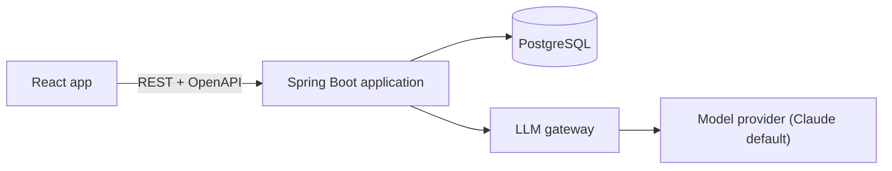

# Workspace Core: Design Spec

**Date:** 2026-11-11
**Status:** Draft for review
**Sub-project:** 1 of 5 (workspace core). Later sub-projects each get their own spec: materials, capture and discovery, autofill, interview.
**Background:** [AI_Career_Copilot_Competitive_Research.md](../../../AI_Career_Copilot_Competitive_Research.md), especially Sections 4, 5.4, 7 and 7A.

## 1. Goal

A job seeker can take a real application from start to finish without losing context: import a CV, confirm their evidence, paste a job description, see eligibility flags and an evidence-backed match, then track the application.

The first user is the author. The product is designed so that other users can be added later without restructuring.

## 2. Decisions already made

| Decision | Choice |
|---|---|
| First audience | The author, then others |
| Capacity | Solo, about six months |
| Deployment | Local now (Docker Compose), hosted later |
| Frontend | React, TypeScript, Tailwind CSS, shadcn/ui |
| Backend | Java (current LTS) with Spring Boot, TypeScript on the frontend |
| Database | PostgreSQL, with Flyway migrations |
| AI provider | Provider-agnostic gateway, Claude as default |
| Work rights | A profile field the user enters; no hard-coded status |
| Interface language | English only in this spec |
| Job text language | English and Chinese job descriptions and CVs are handled |

## 3. Scope

**In scope**

1. Profile and eligibility preferences
2. Evidence library
3. CV storage and versions
4. Job intake from pasted text
5. Matching: eligibility checks and evidence-based fit
6. Application tracker
7. LLM gateway

**Out of scope** (separate specs or later): tailored CV and cover-letter generation, CV comparison and diffing, browser extension, job discovery and source adapters, digests and alerts, form autofill, interview preparation and mock interviews, sign-in and multi-user accounts, billing, Chinese interface.

## 4. Principles

1. **Tracking works without a model.** Any model failure degrades to manual entry, never to a blocked workflow.
2. **Eligibility is code, not model judgment.** The model extracts facts from the job text; deterministic code compares them with the profile.
3. **Unknown is never guessed.** A check that cannot be decided returns `unknown`, not pass or fail.
4. **Only confirmed evidence is used.** Matching never cites unconfirmed, model-suggested evidence.
5. **Fit is a mapping, not a percentage.** Show which requirement is supported by which evidence, and which has none.
6. **Original text is preserved.** The pasted job description and uploaded CV are stored unchanged alongside anything derived from them.
7. **Multi-user ready, single user today.** Every user-owned record carries a `user_id`; requests resolve a current user through one seam.

## 5. Architecture

One Spring Boot application (a modular monolith), one PostgreSQL database, run locally through Docker Compose. No message queue, no separate services.

The backend publishes an OpenAPI description. The TypeScript API client used by the React app is generated from it, so backend and frontend types stay in sync, and the later browser extension can reuse the same client.

### 5.1 Backend modules

One package per module. Modules call each other only through their public service interface, not through each other's persistence classes.

| Module | Responsibility | Depends on |
|---|---|---|
| `profile` | Candidate profile, eligibility preferences | none |
| `evidence` | Evidence items and their confirmation state | `llm` (for CV import suggestions) |
| `cv` | CV file storage, text extraction, versions | `evidence` |
| `job` | Pasted job text, sanitization, extracted structure | `llm` |
| `matching` | Eligibility checks and fit mapping | `profile`, `evidence`, `job`, `llm` |
| `tracker` | Applications and status history | `job`, `cv` |
| `llm` | The only code that calls a model provider | none |
| `common` | Current-user seam, errors, shared value types | none |

### 5.2 Current-user seam

A single `CurrentUser` abstraction returns the user for each request. In this spec it returns one fixed default user created at startup. Adding sign-in later replaces that implementation only; modules and queries already filter by `user_id`.

## 6. Data model

All tables have `id`, `user_id`, `created_at`, `updated_at` unless noted.

**`candidate_profile`** (one per user)
- `career_stage` (student, graduate, experienced)
- `work_rights` (enumerated status such as `student_visa`, `iang`, `gep`, `permanent_resident`, `other`, `unspecified`)
- `languages` (list of language plus level, for Cantonese, English, Mandarin, and others)
- `preferred_districts` (list), `work_modes` (onsite, hybrid, remote)
- `salary_floor_hkd` (nullable), `target_roles` (list)

**`evidence_item`**
- `kind` (experience, project, education, skill, certification)
- `title`, `description`, `start_date`, `end_date`, `organization`
- `source` (`manual`, `cv_import`) and `cv_version_id` (nullable; the version it was suggested from)
- `status` (`suggested`, `confirmed`, `rejected`)

**`cv_version`** (immutable once saved)
- `file_name`, `content_type`, `file_blob_ref`, `extracted_text`
- `label`, `parent_version_id` (nullable)

**`job`**
- `raw_text`, `source_url` (nullable), `sanitized_text`
- `status` (`extracted`, `needs_review`)
- Extracted fields, each nullable and user-correctable: `title`, `hiring_company`, `poster_name`, `poster_type` (employer, recruiter, unknown), `district`, `work_mode`, `salary_min_hkd`, `salary_max_hkd`, `deadline`, `employment_type`, `experience_level`
- `language_requirements` (list of language, level, and the quoted sentence)
- `work_rights_restrictions` (list of restriction type and the quoted sentence)
- `requirements` (list of requirement text, `must_have` or `nice_to_have`)
- `field_origin` per extracted field (`model` or `user`)

**`match_result`** (one per job per profile/evidence snapshot; recomputed when inputs change)
- `eligibility_checks`: list of `{dimension, outcome: pass|fail|unknown, job_quote, profile_value}`
- `requirement_mappings`: list of `{requirement_id, support: direct|transferable|none, evidence_ids, note}`
- `fit_band` (`strong`, `moderate`, `weak`, `insufficient_data`)
- `computed_at`, `inputs_hash`, `model_call_id`

**`application`**
- `job_id`, `cv_version_id` (nullable)
- `status` (`saved`, `preparing`, `applied`, `interviewing`, `offer`, `rejected`, `withdrawn`)
- `applied_at`, `deadline`, `notes`

**`application_status_event`** (append-only)
- `application_id`, `from_status`, `to_status`, `occurred_at`, `note`

**`llm_call_log`**
- `purpose`, `provider`, `model`, `input_tokens`, `output_tokens`, `latency_ms`, `outcome`, `error_kind` (nullable), `prompt_template_version`

## 7. Behavior

### 7.1 Profile and eligibility

The user fills in the profile form. Work rights is a required choice with `unspecified` allowed; when unspecified, work-rights checks return `unknown`. The profile is editable at any time and changes mark existing match results as stale.

### 7.2 Evidence library and CV import

1. The user uploads a CV (PDF or Word). The backend stores the file and extracts text with a Java document-parsing library.
2. The `llm` gateway is asked to propose evidence items from the extracted text. Proposed items are saved as `suggested` with a link to the CV version.
3. The user reviews each suggestion: confirm, edit then confirm, or reject. Only `confirmed` items enter matching.
4. The user can also add evidence items by hand.

If text extraction yields little or no text (for example a scanned PDF), the upload is kept, no suggestions are made, and the user is told to add evidence manually. OCR is out of scope.

### 7.3 CV versions

Each upload creates a new `cv_version`. Versions are never edited. The user labels them and can mark one as the default for new applications. Diffing and generated tailored versions are a later spec.

### 7.4 Job intake

1. The user pastes a job description, with an optional link. If the normalized text matches an existing job, the user is warned and offered the existing job instead of creating a duplicate.
2. The text is sanitized: control and zero-width characters removed, and text that appears to address the model (for example instructions to ignore previous instructions) is flagged and excluded from what the model sees. The original is kept.
3. The `llm` gateway extracts the structured fields in Section 6. Each extracted field that depends on a statement in the text must include the quoted source sentence.
4. The user sees the extracted fields next to the original text and can correct any field. A corrected field has `field_origin = user` and is not overwritten by later re-extraction.
5. If extraction fails validation after retries, the job is saved as `needs_review` with the raw text and empty fields for manual entry.

The extractor separates the poster (employer or recruiter) from the hiring company when the text allows it, and returns `unknown` otherwise.

### 7.5 Matching

Matching produces two independent outputs for a job.

**Eligibility checks (deterministic).** Code compares the profile with the job's structured fields across these dimensions:

| Dimension | Profile | Job | Fail when | Unknown when |
|---|---|---|---|---|
| Work rights | `work_rights` | `work_rights_restrictions` | The job states a restriction the status does not satisfy | Profile is `unspecified` or the job states nothing |
| Languages | `languages` | `language_requirements` | A required language is absent or below the required level | A level is not stated |
| Location | `preferred_districts` | `district` | Never fails; reports mismatch as informational | Job district missing |
| Work mode | `work_modes` | `work_mode` | Job mode not in profile modes | Job mode missing |
| Salary | `salary_floor_hkd` | `salary_*` | Maximum disclosed salary is below the floor | Salary not disclosed |
| Employment type and level | `career_stage` | `employment_type`, `experience_level` | Level or type is clearly outside the stage | Not stated |

Each check records the job quote that caused it. The exact rules live in a small, versioned rule table in code, not in a prompt.

Work rights is the one dimension where the author's own status matters most; the rule table for it is the first thing to review in the implementation plan, because wrong results here are the costliest.

**Fit mapping (model-assisted, code-verified).**
1. For each requirement, the `llm` gateway is given the requirement and the list of confirmed evidence items (id, title, description) and returns `direct`, `transferable` or `none`, with the evidence ids it relied on and a one-line note.
2. Code verifies that every cited id exists, belongs to the user, and is `confirmed`. A mapping that cites an invalid id is downgraded to `none` and logged.
3. Code derives `fit_band` from the verified mappings: weights for `must_have` and `nice_to_have`, and thresholds defined as constants with tests. When the job has no extracted requirements or the user has no confirmed evidence, the band is `insufficient_data`.

The UI shows the band alongside the mappings and eligibility checks. It does not show a numeric percentage.

Match results are recomputed when the profile, evidence set, or job fields change; stale results are labeled until recomputed.

### 7.6 Application tracker

The user creates an application from a job, picks a CV version, and moves it through the statuses. Each status change appends a status event. The list view can filter by status and sort by deadline. Overdue and upcoming deadlines are highlighted. There are no notifications in this spec.

### 7.7 LLM gateway

The only module that imports a provider client. It exposes task-shaped methods (extract job fields, propose evidence from CV text, map requirements to evidence), not a generic chat call.

- **Provider interface:** one interface with a Claude implementation. Adding another provider means adding an implementation, not changing callers.
- **Structured output:** each task defines a schema; responses are parsed and validated, with a bounded number of retries (default 2) on invalid output.
- **Prompts:** stored as versioned templates; the version is recorded on every call.
- **Logging:** every call writes an `llm_call_log` row. Job and CV text are not written to application logs.
- **Configuration:** API key and model name come from environment variables. A missing key puts the app in "no model" mode: the model-dependent actions are disabled with a clear message, and everything else works.

## 8. API surface

REST, JSON, described by OpenAPI. Resources: `profile`, `evidence`, `cv-versions`, `jobs`, `jobs/{id}/match`, `applications`, `applications/{id}/events`. Errors use a single problem-details format with a machine-readable `code`. The detailed endpoint list belongs in the implementation plan.

## 9. Frontend

React, TypeScript, Tailwind, shadcn/ui, with a client generated from the OpenAPI description. Screens:

1. Profile
2. Evidence library (list, confirm or reject suggestions, add)
3. CV versions (upload, label, default)
4. Jobs (paste, review extracted fields beside raw text)
5. Job detail with match view (eligibility checks, requirement-to-evidence mappings, fit band)
6. Applications (list, detail, status history)

Wireframes are not part of this spec; they can be produced during planning if needed.

## 10. Error handling

| Failure | Behavior |
|---|---|
| Model call fails or times out | Retry within limits, then save the job as `needs_review` or return the action as unavailable; nothing else blocked |
| Model returns invalid structure | Retry, then manual entry path |
| Model cites unknown evidence | Mapping downgraded to `none`, logged |
| No API key | "No model" mode |
| CV has no extractable text | Keep file, skip suggestions, prompt for manual evidence |
| Duplicate job paste (same normalized text) | Warn and offer to open the existing job |
| Match inputs changed | Result marked stale until recomputed |

## 11. Privacy and data handling

- All data is stored in the local PostgreSQL database and the local file store.
- Job and CV text are sent to the configured model provider for the three model tasks; this must be stated on the first-run screen and in the README. "Local-first" does not mean "nothing leaves the machine".
- The app supports export of all user data and deletion of all user data. The exact formats are decided in the plan.
- No telemetry.

## 12. Testing strategy

Follows the project's test-first rule for new behavior.

- **Test-first, deterministic code:** eligibility rule table, fit-band derivation, evidence-id verification, sanitization, status transitions, current-user scoping.
- **Integration:** Testcontainers with real PostgreSQL for persistence and migrations.
- **Model-dependent modules:** unit tests against recorded provider responses and fakes; no live model calls in the normal test run.
- **Extraction quality set:** a small collection of real Hong Kong job descriptions (English, Traditional Chinese, mixed) with expected fields, run on demand against the real model to track quality. Source and storage of this set must respect the original postings' terms; use postings the author has permission to keep or write representative ones.
- **Frontend:** component tests for the review and match views; an end-to-end test for the paste-to-tracked-application flow against a fake model.

## 13. Success criteria

1. The author can run the full loop on at least one real application: upload CV, confirm evidence, paste a job, see correct eligibility flags and a fit mapping, create and update the application.
2. No match result cites unconfirmed or nonexistent evidence.
3. With the model disabled, the author can still create jobs manually and track applications.
4. A fresh checkout starts with a single Docker Compose command and a documented environment file.
5. Adding a second user requires replacing the `CurrentUser` implementation, with no query changes.

## 14. Unresolved items

These are facts or choices not settled during design. They must be resolved in planning, not silently assumed.

1. **Java SDK for the model provider.** Not verified whether an official Anthropic Java SDK exists and is suitable; if not, the gateway calls the HTTP API directly. Confirm against current documentation.
2. **Java version and Spring Boot version.** Pick the current LTS and a supported Spring Boot release at planning time.
3. **File storage.** Database blob versus local directory for CV files; default to a local directory behind a small storage interface.
4. **Work-rights rule table.** The precise mapping from job restriction phrases to statuses (for example "permanent resident only", "no sponsorship") needs review with real postings.
5. **Fit-band thresholds.** Initial weights and thresholds are placeholders to be tuned on real jobs.
6. **Extraction-quality set.** Which postings, and under what terms, are kept as test data.
7. **Export and deletion formats.**

## 15. What comes next

See the [roadmap](../../roadmap.md) for scope, dependencies and decision gates of each later sub-project. The next specs, in the suggested order: materials (tailored CV and cover letter with evidence-linked edits), capture and discovery (browser extension and permitted sources), autofill, interview. Each depends on the data model here, so changes to `evidence_item`, `cv_version`, `job` and `application` should be treated as interface changes.

### 15.1 Future agent constraints

An AI agent is expected late in the project. Its language (Java, Python or TypeScript) is deliberately undecided; start in Java unless a concrete need arises, such as an SDK available only elsewhere. To keep that choice open, the core must follow these rules from the start:

1. **Every action is a backend operation.** Anything an agent might do (create an application, confirm evidence, change a status, run a match) is exposed through the published API, never only in the React app.
2. **Agents reach the backend only through its public interface.** That means the REST API or, later, MCP tools published by the backend. An agent never reads or writes the database directly.
3. **Approval checks live in the backend.** Consequential actions, such as moving an application to `applied`, must require a confirmation the backend verifies, so no agent in any language can skip it.
4. **Agent loops are a separate module.** The `llm` gateway stays for single-call tasks (extraction, mapping). Multi-step agent loops are not added to it.
5. **Long-running agent work is tracked as task records** owned by the backend (status, timestamps, failure reason, approval step), consistent with the observability principle in the research document.

Library and SDK support for agents in Java (for example Spring AI, LangChain4j, MCP Java SDK) has not been verified; confirm current versions when the agent spec is written.
